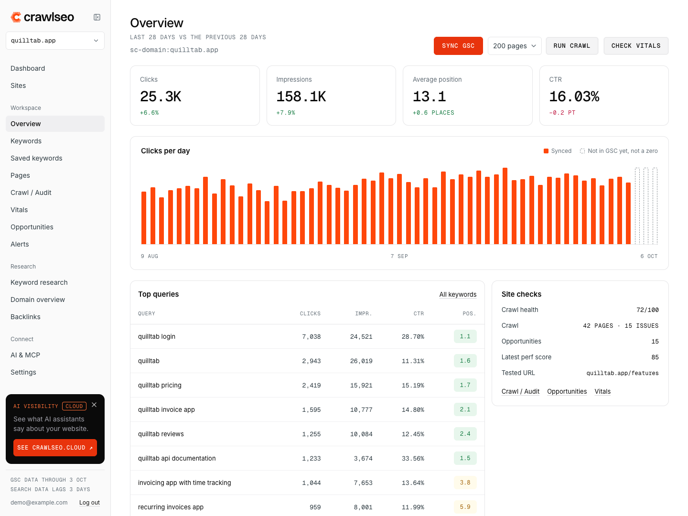
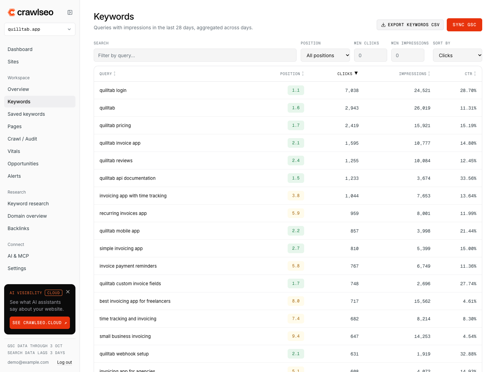
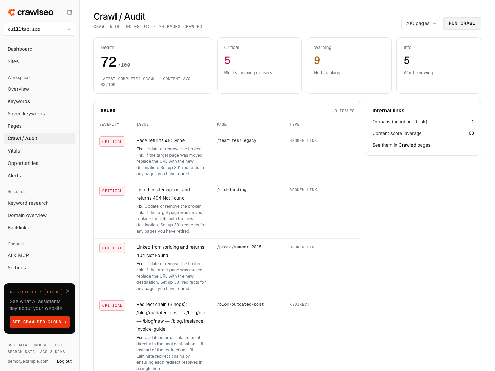
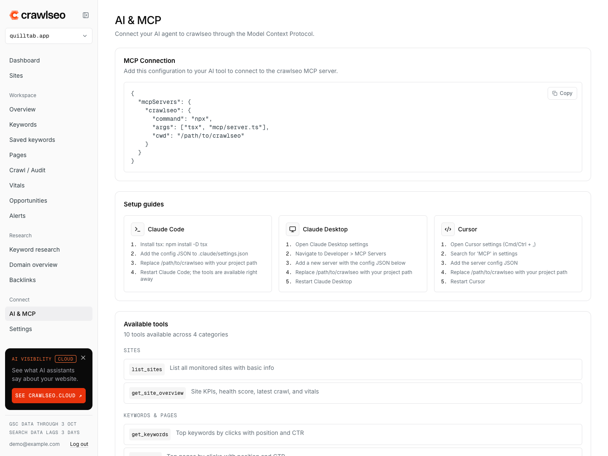

<div align="center">

<h1>
  <picture>
    <source media="(prefers-color-scheme: dark)" srcset="docs/brand/crawlseo-lockup-on-dark.svg" />
    
  </picture>
</h1>

### Open-source SEO monitoring for founders, not SEO specialists

Google Search Console, a site crawler, Core Web Vitals and an MCP server in one self-hosted dashboard. Free forever.

[](https://github.com/crawlseo/crawlseo/stargazers)
[](LICENSE)
[](CONTRIBUTING.md)
[](docker-compose.yml)

</div>

---

<p align="center">
  
</p>

## Why crawlseo?

| | crawlseo | OpenSEO | Ahrefs | Semrush | Moz |
|---|:---:|:---:|:---:|:---:|:---:|
| **Price** | **Free** | $10/mo | €119/mo | $139/mo | $49/mo |
| **Self-hosted** | ✅ | ✅ | ❌ | ❌ | ❌ |
| **GSC integration** | ✅ | ✅ | ✅ | ✅ | ✅ |
| **Site crawler** | ✅ (2000 pages) | ✅ | ✅ | ✅ | ✅ |
| **Core Web Vitals** | ✅ | ❌ | ❌ | ✅ | ❌ |
| **MCP Server** | ✅ (10 tools) | ✅ (24 tools) | ❌ | ❌ | ❌ |
| **AI agent ready** | ✅ | ✅ | ❌ | ❌ | ❌ |
| **Keyword Research** | ✅ (BYOK) | ✅ | ✅ | ✅ | ✅ |
| **Backlinks** | ✅ (BYOK) | ✅ | ✅ | ✅ | ✅ |
| **Open source** | ✅ MIT | ✅ | ❌ | ❌ | ❌ |
| **Your data stays yours** | ✅ | ✅ | ❌ | ❌ | ❌ |

> **BYOK** = Bring Your Own Key. Keyword research and backlink data use DataForSEO (optional). Google Autocomplete suggestions work as a free fallback.

In **Domain overview**, enter a competitor's domain or full website URL and choose **Compare** to query DataForSEO for that domain. Search Console fallback data is only used for your own site; unavailable competitor metrics are shown as unavailable.

## Your data stays yours

crawlseo runs on your server. Your sites, keywords, crawl results and Google tokens stay in your database. We never receive them, and the app sends no usage statistics.

The app talks to outside services only in these cases:

| Destination | When | What is sent | How to turn it off |
|---|---|---|---|
| Google (sign-in, Search Console, PageSpeed Insights) | When you sign in, connect Google, add a site or sync, run a vitals or index status check, or disconnect Google. Also on the schedule: a GSC sync per site each day and a vitals check per site each week | Requests for your own properties and pages | Don't run syncs, vitals or index status checks, or disconnect Google in Settings > Connections. For the schedule: `SCHEDULE_GSC_SYNC_HOURS=0`, `SCHEDULE_VITALS_DAYS=0` or `SCHEDULER_ENABLED=false` |
| Bing Webmaster Tools | Only if you add your own Bing API key; then also a sync per site each day | Requests for your own Bing sites | Remove the key in Settings > Connections, or `SCHEDULE_BING_SYNC_HOURS=0` |
| DataForSEO | Only if you add your own DataForSEO key | The keyword and domain queries you run | Remove the key in Settings > Connections |
| Google autocomplete | Keyword suggestions when DataForSEO is not set up | The seed keyword you typed | Don't use keyword suggestions |
| Sites you crawl | When you start a crawl, and on the schedule a crawl of each site each week (Docker) | Normal HTTP requests from your server, to the site and to the addresses its redirects point to | Don't start a crawl; `SCHEDULE_CRAWL_DAYS=0` or `SCHEDULER_ENABLED=false` for the schedule |
| GitHub releases API | Once a day | A request for the latest crawlseo release. No data about you or your instance. GitHub sees your server's IP address | `CRAWLSEO_UPDATE_CHECK=false` |

Nothing else leaves your server. Alerts are shown in the app only.

The hosts behind these rows are `accounts.google.com`, `oauth2.googleapis.com`, `www.googleapis.com`, `searchconsole.googleapis.com`, `ssl.bing.com`, `api.dataforseo.com`, `suggestqueries.google.com` and `api.github.com`. The list the tests check new code against is [`outbound-hosts.json`](outbound-hosts.json). Your Google profile picture, if you have one, is loaded by your browser from Google, not by the server.

## Features

### 🔍 GSC Analytics

Keywords, pages, clicks, impressions, position tracking with 28-day comparison and delta indicators.

<p align="center">
  
  <br />
  <em>Top keywords with position badges, clicks, impressions, and CTR</em>
</p>

### 🕷️ Site Crawler

Crawl up to 2,000 pages by default (`CRAWL_MAX_PAGES` sets the server's limit) with concurrent fetching. Health score, 16 issue types, content scoring, and remediation guidance.

The crawler (`CrawlSEOBot/1.0 (+https://crawlseo.cloud)`) follows robots.txt per RFC 9309: each host (the bare domain and www included) is checked against its own robots.txt, redirect targets are checked before they are followed, a robots.txt that answers 429 or 5xx, times out or fails with a network error skips that host, and Crawl-delay is honoured. The crawl page lists what robots.txt kept it from.

<p align="center">
  
  <br />
  <em>Crawl results with health score, issue breakdown, and per-page audit data</em>
</p>

### 🤖 MCP server: AI agent integration

10 tools for Claude Code, Claude Desktop, and Cursor. Query your SEO data, run crawls, and find opportunities without leaving the terminal.

<p align="center">
  
  <br />
  <em>MCP setup page with connection config, setup guides, and available tools</em>
</p>

### More features

| | Feature | Description |
|---|---|---|
| ⚡ | **Core Web Vitals** | LCP, CLS, INP, TTFB via PageSpeed Insights with mobile/desktop comparison |
| 🔑 | **Keyword Research** | DataForSEO-powered keyword ideas with volume, difficulty, CPC. Free Google Autocomplete fallback |
| 🔗 | **Backlinks** | Backlink profile, referring domains, anchor text, dofollow/nofollow analysis |
| 📊 | **Rank Tracking** | Historical position snapshots with saved keywords and notes |
| 💡 | **SEO Opportunities** | Striking distance keywords, low CTR, content decay, cannibalization detection |
| 🔔 | **Alerts** | Traffic drops, position drops, low crawl health and degraded vitals. Checked when you press Evaluate now on the Alerts page and shown in the app; nothing is sent by email or chat yet |
| 📥 | **CSV Export** | Export keywords and pages data for offline analysis |

GSC sync, crawls and Core Web Vitals checks run when you start them in the app. There is no built-in schedule yet.

## Quick Start

```bash
git clone https://github.com/crawlseo/crawlseo.git
cd crawlseo
cp .env.example .env.local
# Add your Google OAuth credentials to .env.local
docker compose up -d db
npm install
npx prisma migrate dev --name init
npm run dev
```

Open [http://localhost:3000](http://localhost:3000), sign in with Google, and add your first site.

<details>
<summary>🔑 Getting Google OAuth credentials</summary>

1. Go to [Google Cloud Console](https://console.cloud.google.com/)
2. Create a project (or select existing)
3. Enable the **Google Search Console API**
4. Go to **Credentials** → **Create Credentials** → **OAuth 2.0 Client ID**
5. Application type: **Web application**
6. Authorized redirect URI: `http://localhost:3000/api/auth/callback/google`
7. Copy Client ID and Client Secret to `.env.local`

Required scopes: `openid`, `email`, `profile`, `https://www.googleapis.com/auth/webmasters.readonly`

</details>

## MCP server: AI agent integration

crawlseo includes a Model Context Protocol server so AI agents can query your SEO data directly.

Add to your Claude Code settings (`.claude/settings.json`):

```json
{
  "mcpServers": {
    "crawlseo": {
      "command": "npx",
      "args": ["tsx", "mcp/server.ts"],
      "cwd": "/path/to/crawlseo"
    }
  }
}
```

**10 tools available:**

| Category | Tools |
|---|---|
| **Sites** | `list_sites`, `get_site_overview` |
| **Keywords & Pages** | `get_keywords`, `get_pages`, `get_traffic` |
| **Crawl & Audit** | `run_crawl`, `get_crawl_status`, `get_crawl_issues` |
| **Performance** | `get_vitals`, `get_opportunities` |

Works with Claude Code, Claude Desktop, and Cursor. See [`mcp/README.md`](mcp/README.md) for full setup guide.

## Tech Stack

| Layer | Technology |
|---|---|
| **Framework** | [Next.js 16](https://nextjs.org/) (App Router) |
| **Language** | [TypeScript](https://www.typescriptlang.org/) |
| **Database** | [PostgreSQL](https://www.postgresql.org/) |
| **ORM** | [Prisma](https://www.prisma.io/) |
| **Auth** | [NextAuth.js v5](https://authjs.dev/) |
| **UI** | [shadcn/ui](https://ui.shadcn.com/) + [Tailwind CSS v4](https://tailwindcss.com/) |
| **Charts** | Plain React + Tailwind (no chart library) |
| **Icons** | [Lucide React](https://lucide.dev/) |
| **MCP** | [@modelcontextprotocol/sdk](https://modelcontextprotocol.io/) |
| **Deployment** | Docker Compose |

## Self-Hosting

### Docker Compose (recommended)

```bash
git clone https://github.com/crawlseo/crawlseo.git
cd crawlseo
cp .env.example .env
# Edit .env with your credentials
docker compose pull
docker compose up -d
```

Compose pulls the prebuilt `ghcr.io/crawlseo/crawlseo:latest` image, so deployment
credentials are only needed at runtime. Images support `linux/amd64` and
`linux/arm64`, and database migrations run automatically when the container
starts.

Compose starts three services from that image: `app` (the web app), `worker`
and `db`. The app queues crawls, vitals checks and syncs; the worker runs them,
plus the schedule below, so a long crawl never slows the web app down. See
[Background jobs](#background-jobs).

Image tags:

| Tag | What it is |
|---|---|
| `latest` | The latest release. Moves only when a version is tagged. |
| `0.2.7`, `0.2` | A release, and the newest patch of a minor version. |
| `edge` | The latest build of `main`, ahead of the last release. |
| `sha-<commit>` | One exact build, for main pushes and releases. |

To pin a release, follow `main`, or use an image from a fork, set
`CRAWLSEO_IMAGE` in `.env`:

```bash
CRAWLSEO_IMAGE=ghcr.io/crawlseo/crawlseo:0.2.7
```

To build locally instead, build the same image name before starting Compose:

```bash
docker build -t crawlseo:local .
CRAWLSEO_IMAGE=crawlseo:local docker compose up -d
```

### Run on a server

The defaults above are for a local machine. On a server reachable from the internet, change these before you sign in.

**1. Publish the app port on loopback only.** In `docker-compose.yml`, change the app's port mapping:

```yaml
    ports:
      - "127.0.0.1:3000:3000"
```

Docker writes its own firewall rules for published ports, so they bypass host firewalls such as ufw. With the default `3000:3000` the app answers plain http on the server's public IP even if ufw blocks port 3000. On loopback only the reverse proxy on the same host can reach it.

**2. Put the app behind HTTPS with a reverse proxy.** A minimal [Caddy](https://caddyserver.com/) setup on the host, with your domain's DNS pointing at the server and ports 80 and 443 open (Caddy gets the certificate itself):

```
# /etc/caddy/Caddyfile
seo.example.com {
	reverse_proxy 127.0.0.1:3000
}
```

**3. Set the public URL and the Google redirect URI.** In `.env`, set `NEXTAUTH_URL=https://seo.example.com` and keep `AUTH_TRUST_HOST=true`. In the Google OAuth client, add `https://seo.example.com/api/auth/callback/google` as an authorized redirect URI.

**4. Set your own database password.** Set `POSTGRES_PASSWORD` in `.env` before the first `docker compose up`; the default is `changeme`. Postgres keeps the password it was created with, so changing it later also means changing it inside the database.

**5. Close registration.** Sign in once with your own Google account, then set `DISABLE_REGISTRATION=true` in `.env` and recreate the app container with `docker compose up -d --force-recreate app` (`docker compose restart` does not reread `.env`). From then on only accounts that already signed in can log in. Without it, anyone with a Google account can sign up on your instance and run crawls from your server. A refused account sees "This instance is not accepting new accounts. Ask its owner to sign you up."; set `REGISTRATION_CLOSED_MESSAGE` to say something else, such as where to ask for access.

**6. Keep `NEXTAUTH_SECRET` stable.** It signs sessions and also encrypts stored API keys and Google tokens. If it changes, saved API keys become unreadable and users have to sign in with Google again.

### Manual

```bash
# Prerequisites: Node.js 20+, PostgreSQL

npm install
cp .env.example .env.local
# Configure .env.local

npx prisma migrate deploy
npm run build
npm start
```

`npm start` runs jobs in the app process (`WORKER_MODE=inline`, the default).
To run them in a separate process instead, set `WORKER_MODE=off` for the app
and run `npm run build:worker` once, then `WORKER_MODE=worker node dist/worker.cjs`
next to it.

### Background jobs

Crawls, vitals checks, GSC and Bing syncs and alert evaluation run as jobs in a
queue in your Postgres database. A job that fails for a reason a retry can fix
(a timeout, a network error) is retried after 1, 5 and 25 minutes. One that
cannot be fixed by waiting (an expired Google connection, a missing key, an
exhausted PageSpeed quota) fails at once with its reason. The buttons show
when a job is queued, running or waiting to retry.

**Who runs the jobs** is set by `WORKER_MODE`:

| Setup | App | Worker |
|---|---|---|
| Docker Compose from this repository (recommended) | `off` | `worker` service, `node worker.cjs` |
| One container, or `npm start` | `inline` (the default): the app runs them | none |
| Vercel | `inline`: see [Vercel](#vercel) | none |

An install upgraded from 0.2.x with its old `docker-compose.yml` keeps working
without changes: the app has no `WORKER_MODE`, so it runs the jobs itself, as
it ran crawls before. To move to the worker, take the `worker` service and the
app's `WORKER_MODE: "off"` line from the current `docker-compose.yml`. If the
worker is not running, the buttons say that queued jobs are not being picked up.

On `docker compose stop` (SIGTERM) the worker lets a running sync finish
(up to `WORKER_SHUTDOWN_GRACE_SECONDS`, 25 s by default) and puts a running
crawl back in the queue; it starts again when the worker does. A job whose
process died without stopping is taken back after `JOB_STALE_SECONDS`.

**The schedule.** For every site the app queues a GSC sync and, with a Bing
property and key, a Bing sync each day, then an alert evaluation after each
sync. Each site also gets a crawl (with the page count of its last crawl) and a
vitals check each week. After an upgrade or for a new site, the first
scheduled crawl and vitals check are spread over the first week, never sooner
than a week after the site's last crawl or check, so an upgrade does not crawl
every site at once. Set the intervals with the `SCHEDULE_*` variables (0 turns
one off), or turn the schedule off with `SCHEDULER_ENABLED=false`; the buttons
keep working either way.

### Vercel

There is no long-running process on Vercel, so:

- A button runs its job in the same request after the response, within the
  route's time limit. The routes set `maxDuration = 300`, the most the Hobby plan
  allows ([function duration limits](https://vercel.com/docs/functions/configuring-functions/duration)).
  A crawl stops at that limit and keeps the pages it reached, so large crawls
  are cut short on Vercel; use Docker for them.
- `vercel.json` adds a [cron job](https://vercel.com/docs/cron-jobs) that calls
  `/api/cron/tick` once a day. It queues and runs the daily syncs and alert
  evaluation. Scheduled crawls and vitals checks need the worker, so they run
  on Docker only.
- Set `CRON_SECRET` (a random string of at least 16 characters) in the project's
  environment variables. Vercel sends it with every cron request and the route
  refuses requests without it ([securing cron jobs](https://vercel.com/docs/cron-jobs/manage-cron-jobs#securing-cron-jobs)).
- The Hobby plan runs cron jobs at most once a day, at some point within the
  scheduled hour ([cron limits](https://vercel.com/docs/cron-jobs/usage-and-pricing)).
  On Pro you can change the schedule in `vercel.json` to run more often, for
  example `*/15 * * * *`.

## Environment Variables

| Variable | Required | Description |
|---|---|---|
| `DATABASE_URL` | Yes | PostgreSQL connection string |
| `NEXTAUTH_SECRET` | Yes | Session key, also encrypts stored API keys and Google tokens (`openssl rand -hex 32`). Keep it stable. `AUTH_SECRET` works as an alias |
| `GOOGLE_CLIENT_ID` | Yes | Google OAuth client ID |
| `GOOGLE_CLIENT_SECRET` | Yes | Google OAuth client secret |
| `NEXTAUTH_URL` | No | Public base URL of the app, e.g. `https://seo.example.com`. Set it on a server; locally the request host is used |
| `DISABLE_REGISTRATION` | No | Set to `true` to close sign-up: a Google account that has never signed in on this instance is refused, while accounts that already signed in keep signing in |
| `REGISTRATION_CLOSED_MESSAGE` | No | What the login page tells an account that registration refused. Plain text, at most 200 characters, shown as text (no HTML). Unset or blank keeps the default line |
| `CRAWLSEO_HIDE_CLOUD_PROMO` | No | Set to `true` to remove the crawlseo.cloud card from the sidebar |
| `CRAWLSEO_UPDATE_CHECK` | No | Set to `false` to turn off the daily update check: no request to GitHub is made and the sidebar shows no update notice |
| `CRAWL_MAX_MINUTES` | No | Time limit of one crawl in minutes (default `30`). A host whose Crawl-delay does not fit in it is stopped early, with a message on the crawl page |
| `CRAWL_MAX_PAGES` | No | Most pages one crawl may fetch (default `2000`). The server applies it to every crawl, from the web app and from MCP, whatever page count the request asks for |
| `WORKER_MODE` | No | Who runs queued jobs: `inline` (default, the app process), `off` (this process only queues), `worker` (the worker process). See [Background jobs](#background-jobs) |
| `WORKER_LONG_CONCURRENCY` | No | Crawls and vitals checks one process runs at once (default `1`) |
| `WORKER_SHORT_CONCURRENCY` | No | Syncs and alert evaluations one process runs at once (default `2`) |
| `WORKER_POLL_SECONDS` | No | How often an idle process looks for queued jobs (default `5`) |
| `WORKER_SHUTDOWN_GRACE_SECONDS` | No | How long the worker lets running syncs finish on SIGTERM (default `25`). Keep it below the container's stop timeout |
| `JOB_STALE_SECONDS` | No | A running job whose process sent no heartbeat for this long is taken back (default `180`) |
| `JOB_RETENTION_DAYS` | No | Finished jobs are deleted after this many days (default `30`) |
| `SCHEDULER_ENABLED` | No | Set to `false` to stop all scheduled jobs. Buttons keep working |
| `SCHEDULE_GSC_SYNC_HOURS` | No | Hours between GSC syncs of a site (default `24`, `0` turns them off) |
| `SCHEDULE_BING_SYNC_HOURS` | No | Hours between Bing syncs of a site (default `24`, `0` turns them off) |
| `SCHEDULE_CRAWL_DAYS` | No | Days between scheduled crawls of a site (default `7`, `0` turns them off). Docker only |
| `SCHEDULE_VITALS_DAYS` | No | Days between scheduled vitals checks of a site (default `7`, `0` turns them off). Docker only |
| `CRON_SECRET` | Vercel | Protects `/api/cron/tick`. Without it the route refuses every request |

### The crawlseo.cloud card

The sidebar shows one card about [crawlseo.cloud](https://crawlseo.cloud), the hosted AI visibility product from the same team. It is a plain link to the crawlseo.cloud home page with `utm_source=oss` in the URL (plus `utm_medium=app` and `utm_campaign=sidebar`). The app makes no request for it, loads no image and reports nothing about it. Each user can hide it with the × button (remembered in that browser), and `CRAWLSEO_HIDE_CLOUD_PROMO=true` removes it for everyone on the instance.

## Contributing

Contributions are welcome! See [CONTRIBUTING.md](CONTRIBUTING.md) for guidelines.

```bash
# Fork the repo, then:
git checkout -b feature/your-feature
# Make your changes
git commit -m "feat: add your feature"
git push origin feature/your-feature
# Open a Pull Request
```

## License

MIT License. See [LICENSE](LICENSE) for details.

---

<div align="center">

Built by [Brandson Digital](https://brandson.digital) · Created by [Mike](https://m1ke.digital)

Self-hosted SEO tools should be free. Your data should be yours.

</div>
